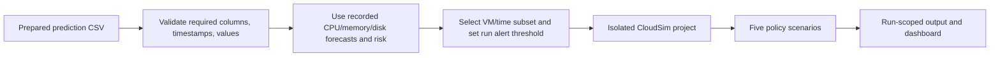

# PatchXProCon Technical Deep Dive

**Audience:** faculty guide review and project presentation  
**Evidence basis:** checked application source, the local training notebook and its saved outputs, live backend health/configuration, dataset metadata, and completed per-run output files.  
**Scope:** this report documents the project as found. It does not change application code, models, data, or simulation outputs.

> **Important evidence note:** Fresh inference and CloudSim execution are present in completed run records. However, the local notebook's Logistic Regression experiment constructs **57 features**, whereas the deployed inference implementation and successfully loaded classifier artifact require **48 features**. The report keeps these facts separate. Do not present the notebook's classifier test metrics as verified evaluation results for the deployed 48-feature classifier until its training provenance is reconciled.

## Executive summary

PatchXProCon is a local research dashboard that connects a Bitbrains workload trace to multi-resource forecasting, a binary risk score, and CloudSim Plus VM placement/consolidation experiments.

The application has two input modes:

1. **Raw workload mode:** reads four Bitbrains resource time series, applies the saved training scaler, runs the saved PatchTST forecaster, calculates engineered risk features, then calls the saved Logistic Regression artifact for probabilities. The generated predictions are sent to CloudSim.
2. **Prepared prediction mode:** reads already recorded CPU, memory, disk, and risk fields from a prepared CSV. This mode does **not** rerun inference; it sends those recorded values to CloudSim.

The current local installation has a raw Bitbrains file with **11,221,800 rows and 1,250 source VM IDs**, a prepared prediction CSV with **456,799 rows and 1,217 VMs**, and model artifacts at `../patch_models/`. The latest persisted completed examples inspected were one raw-inference run (`run_20261101_121611_64d9e6f4`) and one prepared-prediction run (`run_20261102_053635_77e382c3`). Both have output rows for all five policies.

The main scientific qualification is that simulation assumptions are explicit, not measurements from Bitbrains. Host overload counts are simulation snapshots, energy is a simplified estimate, disk I/O is not a placement constraint, and SLA violations are `NOT_MEASURED`.

## 1. Project overview

### Problem and motivation

Cloud workloads vary over time. If virtual machines (VMs) are placed using only current CPU or memory, a host can become overloaded after demand changes. Moving VMs can help, but migrations have costs and are only feasible when another host has sufficient modeled capacity.

### Objective

The project provides an end-to-end research workflow to:

- validate a workload or prepared prediction dataset;
- forecast future CPU, memory, disk read, and disk write from compatible raw Bitbrains measurements;
- estimate the probability of a CPU-overload event and apply a configured alert threshold;
- create simulated VMs and hosts in CloudSim Plus;
- compare five placement/consolidation policies with the same input and host assumptions;
- inspect forecasts, placements, host utilization, migration events, decision records, and comparison metrics in a browser dashboard.

### Contributions actually present in the implementation

- A saved PatchTST checkpoint and scaler are used for raw Bitbrains inference; a saved Logistic Regression-compatible artifact generates risk probabilities.
- Prepared prediction CSVs are supported independently, so previously recorded forecasts can be simulated without relabeling them as fresh inference.
- Run input is copied into a per-run simulator project; outputs are written under a unique run directory instead of overwriting the original CloudSim project/results.
- Raw inference can use per-VM SQLite checkpoints and merge generated rows by `(vm_id, decision_time)`.
- The React dashboard exposes VM/time filtering, simulation assumptions, policy comparisons, placement views, exports, and run history.

**Beginner version:** the system predicts demand, estimates whether an overload alert applies, and tests VM moves in a simulator. It is not a production scheduler controlling a real data center.

## 2. Dataset and preprocessing

### Local datasets inspected

| Dataset | Local file / dataset ID | Mode | Rows | VM IDs | Evidence |
|---|---|---:|---:|---:|---|
| Combined raw Bitbrains | `../patch_models/bitbrains_raw_combined.csv`; dataset ID `c5730ef5a8b6578d8490718ff44882c1` | `raw_workload_csv` | 11,221,800 | 1,250 source IDs | Local dataset metadata and raw run metadata |
| Uploaded prepared Bitbrains predictions | `uploads/8b3e0d16208b4ba39a202630bcc8ad16.csv`; ID `8b3e0d16208b4ba39a202630bcc8ad16` | `prediction_csv` | 456,799 | 1,217 | Upload metadata and completed prepared run |
| Demo prepared Bitbrains | ID `bitbrains`; source results in `../PatchTST-VM-Consolidation/results_v10/` | `prediction_csv` | 456,799 | 1,217 | Dataset catalog and saved v10 outputs |

The raw file is about 777 MB and therefore uses the backend's configured local-file path rather than browser upload. Browser upload is limited to 200 MiB. The prepared uploaded CSV is about 128 MB and is within that limit.

### Raw Bitbrains schema

The raw workload needs a VM identifier (`VM_ID` or `vm_id`), `Timestamp [ms]`, and six resource columns:

| Column | Meaning / unit | Used as PatchTST input? |
|---|---|---:|
| `CPU usage [%]` | CPU percentage | Yes |
| `Memory usage [KB]` | Memory usage in KB | Yes |
| `Disk read throughput [KB/s]` | Read throughput | Yes |
| `Disk write throughput [KB/s]` | Write throughput | Yes |
| `Network received throughput [KB/s]` | Network receive throughput | No; required by the existing raw trace schema/preprocessing |
| `Network transmitted throughput [KB/s]` | Network transmit throughput | No; required by the existing raw trace schema/preprocessing |

Despite its name, the raw timestamp field is interpreted by the notebook and inference code as **Unix seconds**, then converted to a datetime. The local raw validator checks numeric finite timestamps, nonempty VM IDs, resource data types, and whether each VM's rows are contiguous in the combined file. Resource missing values are counted and preserved; negative values are treated as missing by inference. No interpolation is done.

The live raw run considered **all 1,250 IDs**, but only **1,159** yielded at least one valid continuous segment long enough for inference. A valid segment needs 108 consecutive five-minute points: 96 history points plus 12 future points. The other VMs are not silently assigned predictions.

### Prepared prediction schema

The simulator requires these fields:

`vm_id`, `decision_time`, `current_cpu_pct`, `current_memory_kb`, `forecast_cpu_max`, `forecast_memory_max`, `risk_probability`, `risk_threshold`

Recorded disk fields are optional, including:

`current_disk_read_kbps`, `current_disk_write_kbps`, `forecast_disk_read_max`, `forecast_disk_write_max`

The observed prepared Bitbrains CSV contains 19 columns, including forecast means, risk alert, and forecast-window start/end. The prepared data is chronological, has recorded risk values, and is used without rerunning the trained models.

### Notebook preprocessing and splits

The local [`model_patch.ipynb`](../model_patch.ipynb) notebook records the training workflow:

1. Read the Bitbrains VM CSV traces; validate the resource fields.
2. Parse the timestamp values as Unix seconds, sort by time, average duplicate timestamps, and resample to five-minute means.
3. Treat negative resource values as missing and do not interpolate gaps.
4. Require seven days of trace history for the training dataset inclusion criteria.
5. Split each VM's sequence chronologically into **70% train, 15% validation, 15% test**.
6. Fit `StandardScaler` only on complete finite training rows. The notebook output reports **7,200,654 valid training rows** across **1,217 VMs** for that scaler.
7. Form 96-step history / 12-step target windows only within continuous valid segments.

This is a time-ordered holdout, **not k-fold cross-validation**. Since the splits are made in time within each VM, the experiment evaluates later periods for machines also represented earlier in training; it does not establish generalization to entirely unseen VM identities.

The deployed raw preprocessor follows the same core conventions: five-minute mean resampling, sorted/averaged duplicate timestamps, no gap filling, the saved scaler, and model inference on continuous segments. Inference exports a prediction every three resampled steps, i.e. about every 15 minutes. Each exported row summarizes the following 12 five-minute model outputs.

## 3. Model architecture and training versus inference

### PatchTST forecaster

**Beginner version:** PatchTST looks at eight hours of recent VM measurements and predicts the next hour for four resource channels.

**Verified runtime contract:**

- Input: `(batch, 96, 4)` = 96 five-minute observations × four ordered features.
- Output: `(batch, 12, 4)` = 12 future five-minute observations × the same four features.
- Feature order:
  1. CPU usage [%]
  2. Memory usage [KB]
  3. Disk read throughput [KB/s]
  4. Disk write throughput [KB/s]
- Lookback: 96 × 5 minutes = **8 hours**.
- Horizon: 12 × 5 minutes = **1 hour**.
- Patch length 16, stride 8; with a sequence of 96, the implementation creates 11 patches per channel.
- Patch projection: 16 values to 128 dimensions.
- Transformer encoder: 3 layers, 8 attention heads, feed-forward size 256, dropout 0.1, GELU, batch-first and pre-layer normalization.
- Channel-independent processing: each resource channel is patched and encoded as its own sequence; outputs are reshaped back to four channels.
- RevIN is disabled in the deployed architecture; the saved train-only `StandardScaler` is used instead.

The backend reconstructs this architecture, loads the checkpoint strictly, and checks its output shape with a dummy input. The live `/api/health` response reported model inference available and the configuration above.

### Scaler and local trained-model artifacts

The current live backend reported these exact artifact paths:

- PatchTST checkpoint: `D:\PatchTST-VM-Consolidation\patch_models\PatchTST_best.pt`
- Scaler: `D:\PatchTST-VM-Consolidation\patch_models\train_only_scaler.pkl`
- Logistic Regression artifact: `D:\PatchTST-VM-Consolidation\patch_models\adaptive_logistic_regression.joblib`

The default settings are project-relative and can be overridden with `PATCHTST_CHECKPOINT`, `SCALER_PKL`, `LR_CLASSIFIER_PKL`, and `RAW_BITBRAINS_CSV`. The health check verified that the required files load in the current environment; it reported Python 3.10.11, PyTorch 2.9.0, and scikit-learn 1.6.1. The backend requires the classifier's saved scikit-learn version to match its configured version.

### Logistic Regression risk model

**Deployed inference implementation:** for each inference window it constructs 48 values. For each of four channels, it computes:

- history mean, standard deviation, maximum, minimum, last value, most-recent-12 mean, and end-to-end slope: 7 × 4 = 28;
- forecast mean, standard deviation, maximum, minimum, and end-to-end slope: 5 × 4 = 20.

The 48-vector is sent to the loaded classifier's `predict_proba`; the probability for class `1` is stored. The app marks an alert when `risk_probability >= risk_threshold`. The default threshold is **0.66**. The threshold is an application decision cutoff; it is not the probability itself and does not change the predicted probability.

### Training recipe recorded in the notebook

The forecaster notebook uses seed 42, window caps of 300,000 training / 50,000 validation / 100,000 test examples, batch size 256, up to 8 epochs, and patience 3 for early stopping. Its training objective is Huber loss (`delta=1`); it uses AdamW with learning rate `1e-3` and weight decay `1e-4`, gradient clipping at 1.0, and a validation-loss `ReduceLROnPlateau` scheduler (factor 0.5, patience 1). The best validation checkpoint is retained.

The notebook's 57-feature Logistic Regression comparison uses a median imputer, `StandardScaler`, and `LogisticRegression(max_iter=1500, class_weight="balanced", random_state=42)`. The label is whether the **actual** maximum CPU over the next 12 steps exceeds 80%, not whether PatchTST itself predicted an overload. The notebook searches a threshold on validation F1 and reports test metrics separately.

### Provenance discrepancy that must be disclosed

The notebook's Logistic Regression experiment does **not** describe that 48-feature vector. Its source constructs:

- eight historical statistics per resource (32 values);
- five forecast statistics per resource (20 values);
- five additional CPU trend/recent statistics;
- total: **57 features**.

Its saved experiment output reports arrays shaped `(300000, 57)`, `(50000, 57)`, and `(100000, 57)`. By contrast, the backend code asserts that the loaded `adaptive_logistic_regression.joblib` accepts exactly 48 features, and the live health check passed that compatibility check. The checked local project does not provide a matching training script or provenance record that explains how the deployed 48-feature artifact was trained. Therefore:

- The currently loaded 48-feature artifact is used in the actual fresh inference run.
- The notebook's 57-feature classifier scores below are **not verified scores for the deployed artifact**.
- Do not claim that the notebook's Logistic Regression evaluation proves the deployed model's generalization.
- To close this audit gap, preserve a training script/config and metrics for the exact 48-feature artifact, or reconcile the feature extraction and model artifact version.

### What was trained previously, and what is reused now?

The notebook reports training DLinear, PatchTST, and PatchTST+RevIN forecasting alternatives, then evaluates their test predictions. The selected local `PatchTST_best.pt` is loaded for inference; the dashboard does not train it. The notebook also compares Logistic Regression, Random Forest, LightGBM, and XGBoost classifiers. The app loads only the local Logistic Regression-compatible joblib artifact. The scaler was fitted on training-only rows previously and is loaded as-is.

No training, fitting, or scaler refitting happens during a dashboard inference or simulation run.

### Notebook evaluation evidence (not a fresh evaluation in this review)

The notebook's saved output reports the following original-unit test metrics for the non-RevIN PatchTST on its capped 100,000-window test sample:

| Resource | MAE | RMSE | R² |
|---|---:|---:|---:|
| CPU [%] | 1.7746 percentage points | 8.6970 percentage points | 0.7025 |
| Memory [KB] | 232,543.0362 | 1,252,802.0472 | 0.5641 |
| Disk read [KB/s] | 163.4289 | 2,707.0365 | 0.7188 |
| Disk write [KB/s] | 45.8963 | 792.7442 | 0.4455 |

The notebook also reports a best validation Huber loss of 0.031996 for PatchTST and reports eight training epochs in that experiment. These values are notebook evidence, not a separately rerun test of the artifact binary during this documentation task.

For its **57-feature** Logistic Regression experiment, the notebook reports test accuracy 0.9878, precision 0.8346, recall 0.8029, F1 0.8185, ROC-AUC 0.9768, and average precision 0.8707. Its later validation-threshold audit reports threshold 0.93 and revised test F1 0.8152. The test positive rate was 3.425%. Again, because of the 57-vs-48 mismatch, these metrics must not be attributed to the deployed 48-feature artifact.

## 4. Complete workflow

### Raw workload path

### Prepared prediction path

### Per-run execution

1. Dataset metadata distinguishes `raw_workload_csv`, `prediction_csv`, and incompatible raw formats.
2. A raw run loads the saved models and either reuses completed per-VM checkpoint entries or computes predictions for missing selected VMs. A prepared run skips this stage.
3. The runner creates a unique run ID and makes a private simulator copy containing the simulator source/build files and selected CSV.
4. The selected input is revalidated against the Java simulator's required columns, finite values, local timestamp format, and global chronology.
5. Maven compiles and executes the copied project, not the original simulator project.
6. The Java program loops through all five policy enum values, writing ML_PROACTIVE to the primary output folder and the others to separate `comparison/<policy>` folders.
7. The backend records stage metadata and output files under the run ID; dashboard queries require a matching dataset/run context.

## 5. CloudSim Plus and consolidation policies

### Simulator assumptions

The Java simulator uses CloudSim Plus 8.5.7. Default assumptions in source are:

| Assumption | Default |
|---|---:|
| Hosts | 200 |
| Host RAM | 262,144 MB |
| Host PEs / cores | 32 |
| Host PE MIPS | 1,000 |
| VM PEs | 4 |
| VM PE MIPS | 1,000 |
| CPU overload limit | 0.80 |
| RAM overload limit | 0.80 |
| Decision interval | 900 seconds (15 minutes) |
| Migration cooldown per VM | 1,800 seconds |
| Stale workload sample limit | 1,800 seconds |
| Extra destination PE headroom | 1 PE |
| Host bandwidth / storage configuration values | 1,000,000 / 10,000,000 (simulator units) |

Host count, RAM, PE count, and CPU/RAM limits can be overridden for a run within API bounds. These capacities are simulation assumptions, not Bitbrains measurements.

Each dataset VM becomes a CloudSim VM. Its modeled provisioned RAM is based on 120% of the maximum recorded current/forecast memory over its trace, rounded up to a 1-GB boundary with a 2-GB minimum and capped at host RAM. VM CPU allocation is four PEs. Initial placement uses CloudSim's first-fit allocation policy.

The simulated cloudlet's CPU utilization is replayed from the current CPU observations. Forecast values are used for proactive load estimation and placement decisions; the simulator is not executing actual workload code from Bitbrains.

### Policy behavior in this code

| Policy | Candidate selection and action in this implementation |
|---|---|
| **ML_PROACTIVE** | Considers active VMs whose risk probability meets the run threshold, ordered by risk descending. Uses the maximum of current and forecast CPU/RAM for overload and placement feasibility. If the source host is overloaded and a feasible destination exists, requests a migration. |
| **REACTIVE** | Considers all active VMs, ordered by combined current CPU and RAM load. Uses current load; migrates when the source host exceeds configured CPU or RAM limits. |
| **NO_MIGRATION** | Baseline scenario that creates/places VMs but does not evaluate migration candidates or request moves. |
| **MMT** | Selects VMs from currently overloaded hosts, ordered by provisioned RAM ascending as a proxy for shorter migration time. Uses current load for overload and destination tests. |
| **PABFD** | Considers active VMs ordered by current CPU utilization, acts only when the source host is overloaded, and selects a feasible destination with the least estimated linear-model power increase. |

For ML_PROACTIVE, REACTIVE, and MMT, feasible placement uses a best-fit rule that prefers already occupied hosts and then the highest projected load still below configured limits. All placement checks consider CPU, RAM, free PEs, extra PE headroom, migration state, and CloudSim resource suitability. Only one migration is allowed in flight at a time; per-VM cooldown, pending moves, and in-flight source/target hosts can defer decisions.

These are the behavior of this implementation. They are research baselines/heuristics, not evidence that every named policy exactly implements every variant found in the literature.

### Migration events and metrics

- A migration request is recorded when the policy calls CloudSim's migration API.
- A start event is captured by a VM migration listener.
- Success is counted only when the migration-finish event reports success and the VM is observed on the requested target host.
- Failed or incomplete moves are tracked separately.
- `decision_rows` count policy evaluations, not input CSV rows; a row can occur at a simulation interval for a candidate VM.
- `host_cpu_overload_snapshots` and `host_ram_overload_snapshots` count occupied-host samples above configured forecast/current load thresholds. Combined `host_overload_snapshots` counts unique host/time pairs above either CPU or RAM limit.
- CPU load is mapped as `vm_cpu_pct * VM_PES / HOST_PES`; RAM KB is divided by 1,024 to obtain MB.
- Disk read/write are forecast and displayed when present but do not constrain host placement.

### Energy calculation

The simulator assigns a `PowerModelHostSimple` linear model with 100 W idle and 250 W peak. It estimates each host's average power from mean CPU utilization, multiplies by host uptime, sums watt-seconds, and divides by 3,600,000 for kWh. This is an approximate modeled energy figure. There is no host power-down model, and the estimate is not a real meter reading or a measured facility saving.

## 6. Dashboard pages and visualizations

The front end is React + TypeScript with Vite. Recharts renders charts; `@xyflow/react` renders the host/VM topology. The dark theme and navigation are part of the existing UI.

### Pipeline: Upload & validate

- Choose and upload a CSV (maximum 200 MiB) or validate the configured large local raw CSV without browser transfer.
- Displays file name, row/VM counts, schema validity, warnings, and errors.
- Detects prepared predictions versus compatible raw Bitbrains; Alibaba-like raw schemas are identified as incompatible with the model's memory/disk units.
- A saved dataset picker can switch between registered datasets.
- Run Pipeline opens the simulation path for the selected dataset; browser uploads are stored with metadata and a dataset ID.

### Pipeline: Forecasts

- Mode badge distinguishes **Fresh inference**, **Recorded predictions**, or a pending/incompatible state.
- VM ID search and selector use actual prediction records available for the selected dataset. Time bounds and forecast-row search filter the displayed series.
- Current CPU and forecast CPU maximum are charted over records for the selected VM.
- Current and forecast memory are converted from KB to MB for display. The series uses the current memory and forecast maximum.
- A CPU forecast series additionally exposes a simulator-display clamp to [0, 100]; this is a display helper, while the simulator input retains the source forecast value.
- Risk probability, threshold, and the corresponding alert status are shown in cards. `ALERT` is `p >= threshold`; otherwise `NO ALERT`.
- Disk data is displayed in a table when the selected prediction data contains disk fields. It is not a placement constraint.
- The chart x-axis values are timestamps (currently hidden visually); points are ordered by `decision_time`.

### Pipeline: CloudSim

- Select a primary/display policy (the simulator still executes all five policies), VM IDs or all VMs, and optional inclusive start/end window.
- Configure risk threshold, host count, host RAM, host PEs, and CPU/RAM overload limits.
- Run status shows stages and counts. Raw runs expose inference mode and processed VM count; prepared runs identify their recorded-prediction mode.
- Run history can select earlier completed runs. The run-scoped summary only loads when dataset ID, run ID, and policy match.
- Detailed process logs are kept in a collapsed technical details section.

### Results: Run summary

**KPI cards**

- Virtual machines: distinct VMs in the selected simulation result.
- Configured hosts: configured simulator host count.
- Migration requests and successful migrations: counts from actual simulator output for the selected policy.
- Host overload snapshots: actual output counts, labeled as simulation proxies.
- Energy estimate: actual simulation output from the linear model, labeled approximate.

**Charts and tables**

- Energy by policy: approximate kWh from each policy output.
- Migration counts by policy: migration requests versus confirmed successful migrations.
- Recent migration events and recent simulation decisions: slices of actual event/decision output, with links to their explorers.
- SLA status is explicitly `NOT_MEASURED`; overload snapshots are not shown as SLA violations.

### Results: VM forecasts

Shows the chosen run's prediction series, current/forecast CPU and memory charts, risk/threshold/alert cards, optional disk fields, and simulator-associated VM placement/migration details. Whether predictions are fresh or recorded is determined by run/dataset metadata, not inferred from the numeric values.

### Results: Hosts & placement

- Host search narrows the host list.
- Selected-host cards show current and forecast CPU/RAM fractions, RAM MB, and VM count at a snapshot.
- A host time series compares current/forecast CPU and RAM.
- React Flow topology displays hosts and their assigned VMs for that result.
- Tables list VMs currently recorded on the selected host and migration history touching it.
- These values come from the selected simulation's host, placement, and migration output files.

### Results: Migrations & ledger

- Migration Explorer provides events with status, VM, source/destination host, timestamp, and details.
- Decision Ledger records time, VM, risk probability, threshold, decision, current/proposed host, and reason. It defaults to actionable entries rather than repetitive KEEP rows.
- Both views support search, event/decision and host filters, sorting, page size, pagination, and CSV export.

### Results: Compare runs / Policy Benchmark

- Shows available policies for one completed simulation run, and clearly lists pending/unavailable policies rather than duplicating/fabricating rows.
- A selectable metric drives the policy comparison bar chart. The table displays run ID, energy, migration counts, no-feasible-destination counts, overload proxy snapshots, and decision rows.
- Search/sort and comparison CSV export use the same selected dataset/run context.

### Tables, search, pagination, and exports

The table component paginates locally supplied rows (typically with 25 rows/page); event and decision tables use backend pagination, where filtering and sorting are applied before page slicing. APIs also expose paginated VM lists. Exports are generated from the matching run's available result CSVs, with policy comparison rows assembled from actual per-policy summary/output files.

## 7. Completed results inspected

These are persisted examples, not results newly generated for this report.

### Raw Bitbrains: fresh model inference followed by CloudSim

**Run:** `run_20261101_121611_64d9e6f4`  
**Dataset:** raw `bitbrains_raw_combined.csv`, ID `c5730ef5a8b6578d8490718ff44882c1`  
**Input mode:** `fresh_predictions`  
**Run selection:** requested window 2013-08-13 00:00 through 03:00; 200 hosts; 262,144 MB RAM; 32 PEs; CPU/RAM limits 0.80; risk threshold 0.66.

- Input IDs processed: **1,250 / 1,250**.
- IDs with generated predictions: **1,159**.
- Fresh predictions: **13,908 rows** (12 records per eligible VM in this run).
- Prediction decision timestamps in simulator output: **2013-08-13 00:05 to 02:50**.
- Run duration recorded: approximately **89.8 seconds** from start to finish.
- Stage times: model loading 0.007 s; preprocessing 0.159 s; forecasting/risk scoring 76.932 s; prediction writing 0.919 s; isolated project preparation 0.139 s; Maven/CloudSim execution 11.623 s.

| Policy | Migration requests | Successful | Host overload snapshots (CPU or RAM proxy) | Energy estimate (kWh) |
|---|---:|---:|---:|---:|
| ML_PROACTIVE | 12 | 12 | 58 | 72.2736 |
| REACTIVE | 8 | 8 | 49 | 72.2633 |
| NO_MIGRATION | 0 | 0 | 86 | 72.2524 |
| MMT | 12 | 12 | 63 | 72.2575 |
| PABFD | 9 | 9 | 46 | 72.2751 |

All five policies report zero failed/incomplete migrations and zero no-feasible-destination decisions in this run. The ML_PROACTIVE output reports 2,439 risk-alert rows, 58 CPU-overload snapshots, 0 RAM-overload snapshots, 2,623 candidate decision rows, 1,159 allocated VMs at end, and SLA `NOT_MEASURED`.

### Prepared Bitbrains: recorded predictions followed by CloudSim

**Run:** `run_20261102_053635_77e382c3`  
**Dataset:** uploaded prepared prediction CSV, ID `8b3e0d16208b4ba39a202630bcc8ad16`  
**Input mode:** `prediction_csv` / recorded predictions. No fresh model inference is attributed to this run.  
**Input:** **456,799 recorded prediction rows**, **1,217 VMs**; simulation timeline 2013-08-20 09:15 to 2013-09-11 12:35; default 200-host assumptions.

| Policy | Migration requests | Successful | Host overload snapshots (CPU or RAM proxy) | Energy estimate (kWh) |
|---|---:|---:|---:|---:|
| ML_PROACTIVE | 14 | 14 | 19 | 10,636.7912 |
| REACTIVE | 8 | 8 | 25 | 10,636.7877 |
| NO_MIGRATION | 0 | 0 | 255 | 10,636.7914 |
| MMT | 8 | 8 | 22 | 10,636.7877 |
| PABFD | 8 | 8 | 21 | 10,636.7878 |

All five policy outputs report zero failed/incomplete migrations and zero no-feasible-destination decisions. The ML_PROACTIVE summary reports 47,996 risk-alert rows, 19 CPU-overload snapshots, zero RAM-overload snapshots, 48,255 decision rows, and 1,217 allocated VMs at end.

The raw and prepared energy totals should not be compared as model-quality scores: they cover different VM counts, trace durations, risk/prediction sources, and simulated time spans. These are outputs under the stated assumptions, not a controlled energy-saving experiment against a measured baseline.

## 8. Dynamic behavior and result isolation

| Change | Expected effect |
|---|---|
| Re-select same dataset and same completed run | Same persisted prediction and simulation output is displayed; no fresh inference is implied for prepared data. |
| Select a different VM or forecast time window | Changes the forecast records and values displayed for that VM/window. Does not itself retrain the model. |
| Change VM selection/time window for a new simulation | Selects a subset of prediction rows/VMs and produces a new run ID and policy outputs. |
| Change risk threshold | Changes the alert decision (`p >= threshold`) and therefore ML_PROACTIVE candidates. It does not change a saved probability. The per-run selected CSV gets the new threshold/alert value; source CSV remains unchanged. |
| Change host count, host RAM/PEs, or CPU/RAM limits | Changes simulated feasibility, placement, overload snapshots, and potentially migrations/energy. |
| Change policy selector in Simulation Control Room | Chooses which policy is foregrounded in the dashboard; the Java program still emits all five policies for the same selected input and assumptions. |
| Upload/select another dataset | Selects the associated dataset ID and resets dataset-bound result/filter state so records from a prior dataset should not be presented as the active selection. |

Raw inference stores per-dataset predictions and per-window SQLite checkpoint data. Each run also gets its own run ID, selected CSV, simulator copy, logs, and outputs. The backend associates result APIs with dataset and run IDs to avoid mixing outputs. Prepared prediction values remain the source of truth for prepared mode.

Exact bit-for-bit repeatability is not claimed: model/runtime/device details and simulator execution environment can affect exact numerical reproducibility, and a new run always has its own ID/output directory.

## 9. SLA and other limitations

1. **SLA is not measured.** The simulator explicitly writes `sla_violations=NOT_MEASURED`. Overload snapshot counts are proxies from modeled CPU/RAM loads, not user-observed response-time or SLA breaches.
2. **Energy is estimated.** It uses a simple 100 W idle / 250 W peak linear host power model and uptime/mean CPU values. No physical power measurements or calibrated server-specific curve is available.
3. **No host power-down model.** Occupied-host counts can be shown, but zero powered-down hosts means consolidation energy savings from shutting down machines are not actually modeled.
4. **Disk I/O is not a placement constraint.** Disk fields can be forecast/displayed, but host feasibility is based on modeled CPU/RAM/PE/bandwidth/storage resource checks; disk throughput is marked `NOT_MODELED`.
5. **Host/VM capacity is assumed.** Bitbrains traces do not supply the physical host capacity used by this simulator.
6. **Risk is a classifier output, not a guarantee.** The threshold is configurable, the notebook defines a CPU-overload target (>80% actual CPU in the next hour), and the classifier provenance mismatch must be resolved before making strong claims about deployed risk-model accuracy.
7. **No demonstrated cross-dataset validation.** Alibaba memory percent and disk-space percent are not the trained model's memory KB and disk throughput. The app appropriately rejects that mapping rather than inventing measurements or probabilities.
8. **Training evidence is not fully local.** The notebook embeds prior training outputs and references its former Drive paths, but the inspected local tree does not contain the complete training split directories or an end-to-end reproducible 48-feature classifier training pipeline.
9. **One primary run at a time.** The backend runner rejects another active simulation in the same process; README recommends one Uvicorn worker.
10. **Resource aggregation loses detail.** Duplicate timestamps are averaged and data are resampled into five-minute bins; sub-five-minute behavior is not modeled by the forecaster.

## 10. Technical implementation

### Components and technologies

| Layer | Technologies and role |
|---|---|
| Frontend | React 18, TypeScript, Vite, Recharts, `@xyflow/react`; dashboard state, charts, topology, filters, tables, and exports |
| API/backend | Python 3.10, FastAPI, Uvicorn, Pydantic settings, pandas, NumPy; dataset validation, model inference, run lifecycle, result APIs |
| Forecasting | PyTorch PatchTST model, scikit-learn-compatible scaler/classifier, joblib artifacts |
| Persistence | JSON metadata, CSV datasets/results, SQLite per-VM inference checkpoint/merge tables |
| Simulator | Java / Maven, CloudSim Plus 8.5.7; VM allocation, event-driven migration, host utilization, summary CSVs |

### Important API groups

- Health/config: `GET /api/health`
- Dataset catalog/validation/select/upload: `/api/dataset/metadata`, `/validate`, `/upload`, `/local/validate`, `/select`
- Inference-only endpoint: `POST /api/dataset/infer` (generates raw predictions without launching CloudSim)
- Asynchronous run lifecycle: `POST /api/runs`, `GET /api/runs`, `GET /api/runs/{run_id}`, `GET /api/runs/{run_id}/logs`
- VM list/details: `GET /api/vms`, `GET /api/vms/{vm_id}`
- Results: `/api/overview`, `/api/policies/{policy}/summary`, `/migrations`, `/decisions`, `/hosts`, `/placements`
- CSV exports: `/api/export/policy_comparison`, `/api/export/{policy}/migrations`, `/api/export/{policy}/decisions`

### Persistence, checkpointing, asynchronous work

- Dataset uploads and validation metadata are stored under `backend/uploads/`; active dataset selection has its own metadata.
- A simulation request returns a run record, then a background thread performs inference if needed, prepares the selected data, copies the simulator, runs Maven, validates result files, and updates run metadata.
- Run metadata/logs/output are stored under `backend/runs/<run_id>/`. The copy contains the Java source and selected input; the original CloudSim source/results are not used as the writable run directory.
- Raw inference reads the CSV in 50,000-row chunks and processes each contiguous VM trace. Window batches are 256. A SQLite database stores predictions with primary key `(vm_id, decision_time)` and a `completed_vms` table; completed VM work is committed so an interrupted job can resume.
- Existing and new inference rows are merged through a temporary SQLite table with the same composite key, sorted by timestamp and VM. This prevents duplicate VM/time rows in the merged prediction file.
- Run stages include queued, model loading, preprocessing, forecasting/risk scoring, writing predictions, isolated-project preparation, and compile/run. Progress reports stage and completed VMs rather than claiming a fabricated percentage.

## 11. Likely faculty questions and accurate answers

### “What exactly does the model predict?”

PatchTST predicts 12 five-minute points for four channels—CPU, memory KB, disk read KB/s, disk write KB/s—from 96 five-minute history points. The dashboard exports summary max/mean values for each channel and time window. It does not predict VM placement directly.

### “What is the risk score?”

It is the class-1 probability from a Logistic Regression-compatible classifier applied to engineered summaries of history and forecast. An alert is raised when the probability is at least the configured threshold (default 0.66). A risk alert is not the same as a measured SLA violation.

### “Why PatchTST?”

The notebook evaluates DLinear, PatchTST, and PatchTST+RevIN on a capped chronological test sample. It reports PatchTST's best validation Huber loss as 0.031996 and per-resource original-unit metrics. This supports the notebook's model choice, but it does not establish that it is universally superior or best on other traces.

### “Was the model trained when I upload a CSV?”

No. The app loads the saved checkpoint, scaler, and classifier for raw Bitbrains inference. The prepared CSV path does no inference at all; it uses recorded prediction and risk columns. CloudSim then simulates those inputs.

### “Can I use Alibaba Cluster Trace 2017 with these trained models?”

Not honestly for this existing four-channel inference pipeline without a verified mapping and compatible units. In this installation, Alibaba's memory percentage and disk-space percentage do not equal memory in KB and disk read/write throughput. The application preserves/rejects that input instead of fabricating channels, forecasts, or risk values. A legitimate cross-dataset study requires either a dataset with equivalent measured channels/units or a separately designed and evaluated preprocessing/model adaptation.

### “Is the risk classifier's performance verified?”

The notebook contains classifier scores, but its classifier experiment uses 57 features. The running backend checks and loads an artifact requiring 48 features, and fresh inference succeeded with that deployed interface. Until the 48-feature artifact's training pipeline is documented and evaluated against held-out labels, the notebook's classifier scores must not be claimed for the deployed artifact.

### “Why is the alert threshold 0.66 if the notebook selected another threshold?”

The running application config sets 0.66 as the operational decision cutoff; changing it changes alert flags and proactive simulation decisions, not the generated probability. The notebook's 57-feature classifier audit selected 0.93 on validation. That difference and the feature-count mismatch are reasons to document threshold provenance and recalibrate/evaluate the exact deployed artifact before making a calibrated-risk claim.

### “Is this k-fold cross-validation?”

No. The notebook describes chronological per-VM 70/15/15 train/validation/test partitions. The validation partition is used for model selection and threshold tuning; the test partition reports holdout metrics. It is not k-fold CV, and because VM identities recur across time splits, it does not measure unseen-VM generalization.

### “What do the migration counts mean?”

Requests are policy-issued migration requests. Successful migrations are confirmed by CloudSim's migration-finish event and the VM's actual host matching the requested destination. They are not inferred from a policy decision row.

### “Why can decision rows greatly exceed prediction rows?”

Policies can evaluate active VM candidates repeatedly at each simulation decision interval. `decision_rows` count those evaluations, while prediction rows count input samples. They are different units of measurement.

### “Are overload snapshots SLA violations?”

No. They count modeled host/time snapshots above configured CPU or RAM limits. The simulator has no explicit SLA measurement, so its summary correctly reports `NOT_MEASURED`.

### “Does the energy chart prove the policy saved electricity?”

No. It reports estimated kWh under the code's simple linear host power model. There is no calibrated host-specific power curve, real meter, or host power-down behavior; raw and prepared timelines are also not directly comparable.

### “Are all five policies compared on the same input?”

In a completed dashboard run, the Java driver loops through all five policy enum values against the same selected prediction CSV and run-level host assumptions. Each policy gets a separate output directory. Changing the primary policy in the UI only changes which policy is foregrounded for viewing.

### “What does PABFD mean here?”

The implementation sorts active candidates by current CPU and, when an overloaded source host triggers a move, chooses a feasible destination with minimum increase in the configured linear power model. It is the behavior in this code; it should be described as this project's implementation rather than asserted to be identical to all published PABFD variants.

### “How does the system avoid mixing runs?”

Every simulation has a unique run ID and a dataset ID. Inputs, simulator copy, outputs, and metadata are run-scoped; result APIs verify that the requested run belongs to the selected dataset and is complete. Dataset switching resets dataset-specific UI state.

### “What are the strongest limitations to state in the presentation?”

The classifier training-provenance mismatch (57 notebook features vs 48 deployed features), no k-fold or unseen-VM evaluation, assumed host capacities, heuristic policy implementations, no disk constraint, `NOT_MEASURED` SLA, and approximate energy are the most important qualifications.

## 12. Evidence map and files inspected

### Application

- [`README.md`](README.md) — feature/mode overview, paths, input contract, run isolation, limitations.
- [`backend/app/config.py`](backend/app/config.py) — artifact path resolution, simulator settings, default threshold, policy list.
- [`backend/app/data.py`](backend/app/data.py) — raw/prepared validation, schema, preprocessing compatibility messages, metadata caching.
- [`backend/app/inference.py`](backend/app/inference.py) — model architecture, artifact checks, feature engineering, chunked/checkpointed inference.
- [`backend/app/runner.py`](backend/app/runner.py) — async run lifecycle, selected predictions, isolated project, Maven execution, output checks.
- [`backend/app/routers/dataset.py`](backend/app/routers/dataset.py), [`runs.py`](backend/app/routers/runs.py), [`vms.py`](backend/app/routers/vms.py), [`policies.py`](backend/app/routers/policies.py) — API behavior, dataset/run IDs, result queries, pagination, exports.
- [`frontend/src/App.tsx`](frontend/src/App.tsx) and [`frontend/src/styles.css`](frontend/src/styles.css) — pages, filters, cards, charts, topology, run controls, tables.
- [`backend/requirements.txt`](backend/requirements.txt), [`frontend/package.json`](frontend/package.json) — principal dependency versions.

### Training, artifacts, inputs, and outputs

- [`../model_patch.ipynb`](../model_patch.ipynb) — training/preprocessing source and saved notebook outputs. It references its former Colab/Drive environment; those paths are not the app's local model paths.
- [`../patch_models/PatchTST_best.pt`](../patch_models/PatchTST_best.pt), [`../patch_models/train_only_scaler.pkl`](../patch_models/train_only_scaler.pkl), [`../patch_models/adaptive_logistic_regression.joblib`](../patch_models/adaptive_logistic_regression.joblib) — local inference artifacts.
- [`../patch_models/bitbrains_raw_combined.csv`](../patch_models/bitbrains_raw_combined.csv) — configured combined raw Bitbrains file.
- [`uploads/8b3e0d16208b4ba39a202630bcc8ad16.json`](uploads/8b3e0d16208b4ba39a202630bcc8ad16.json) — prepared uploaded dataset metadata.
- [`runs/run_20261101_121611_64d9e6f4/meta.json`](runs/run_20261101_121611_64d9e6f4/meta.json), [`runs/run_20261101_121611_64d9e6f4/output/`](runs/run_20261101_121611_64d9e6f4/output/) — raw run metadata and five policy outputs.
- [`runs/run_20261102_053635_77e382c3/meta.json`](runs/run_20261102_053635_77e382c3/meta.json), [`runs/run_20261102_053635_77e382c3/output/`](runs/run_20261102_053635_77e382c3/output/) — prepared run metadata and five policy outputs.

### Simulator

- [`../PatchTST-VM-Consolidation/src/main/java/Main.java`](../PatchTST-VM-Consolidation/src/main/java/Main.java) — policy loop, host/VM assumptions, decision rules, migration listeners, CSV outputs, overload and energy formulas.
- [`../PatchTST-VM-Consolidation/pom.xml`](../PatchTST-VM-Consolidation/pom.xml) — Java/Maven dependencies, including CloudSim Plus.

## Final presentation message

> “PatchXProCon takes either compatible raw Bitbrains measurements or an already prepared prediction CSV. Raw mode applies previously trained, locally saved model artifacts to produce CPU, memory, disk, and risk forecasts; prepared mode uses recorded values without claiming fresh inference. CloudSim Plus then evaluates five policies on the same selected workload under explicit simulated host assumptions. The dashboard reports actual run outputs, but energy is estimated, overload is only a simulation proxy, and SLA violations are not measured. The local notebook's classifier feature count does not currently match the deployed classifier input contract, so classifier accuracy claims require a provenance/evaluation follow-up.”
